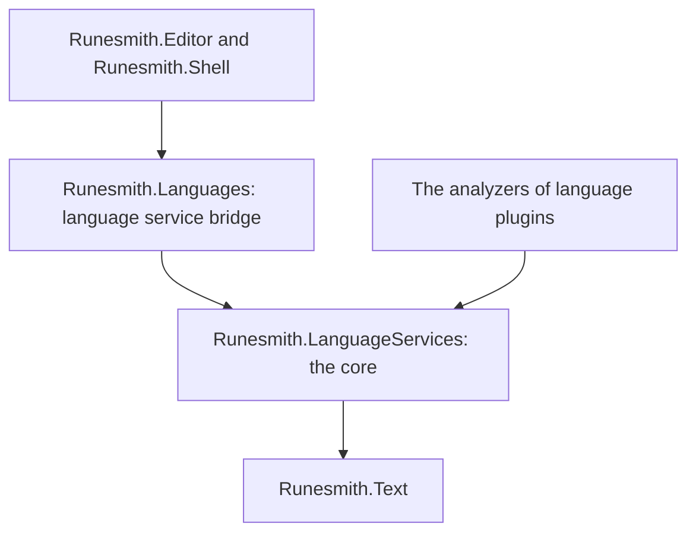

# Language services

Runesmith understands code through its language services: one shared core that keeps documents, schedules work and serves editor
requests, and one analyzer per language. Runesmith ships the core and no analyzer: each analyzer comes from the plugin of its language.
This document describes the core.

An analyzer in the editor's process answers from the editor's own text snapshots, which an external language server cannot: a server gets
the text as JSON over a process boundary, and answers the same way. Runesmith supports both; a plugin chooses.

## Principles

1. **The editor never waits.** Typing, drawing and moving the caret never block on analysis. Analysis answers asynchronously, and an answer
   for an older version of the text is still useful when it is moved through the edits made since.
2. **Interactive requests come first.** Completion and signature help preempt hover and navigation, which preempt diagnostics and
   indexing. Work for an older version of a document is cancelled when a newer one arrives, unless it is close to done and still useful.
3. **Share, do not copy.** In the editor's process, a language service reads the editor's own immutable text snapshots. No text is
   serialized, and an edit is passed as the changes it made.
4. **Do the minimum, filter at the source.** A completion request returns the suggestions that match what is typed, ranked, capped, and
   with their details left for when they are shown.
5. **Measure everything.** Every request records its latency per stage, so a regression shows up in the performance report and in the
   benchmarks before a user feels it.

## Architecture

| Project | Responsibility | Dependencies |
| --- | --- | --- |
| `Runesmith.LanguageServices` | The core: documents, workspaces, the scheduler, the request pipeline, completion ranking, caches, metrics | `Runesmith.Text` only |
| `Runesmith.Languages` | The bridge: turns analyzers and language servers into the editor's language features | The core, `Runesmith.Lsp`, the SDK |

The core carries no compiler and knows no language. An analyzer is an `ILanguageAnalyzer` that a plugin exports; the plugin brings the
compiler or the parser it needs in its own folder. The designs of the official analyzers are in their plugins' repositories.

### In process or out of process

The editor runs analyzers in its own process: that is the only way to share text snapshots and to answer in microseconds what a separate
process answers in milliseconds. A plugin that wants its analysis in a process of its own brings a language server instead.

## The core

### Documents and versions

A `SourceDocument` is a path, a language, a version number and a `TextSnapshot` from `Runesmith.Text`. Snapshots are immutable and share
structure, so keeping the last few versions costs little and reading them from any thread is safe.

- **Open, change, close.** The bridge tells the core when the editor opens, changes or closes a document. A change passes the new snapshot
  and the `TextChange` list that made it, so an analyzer can update incrementally, such as by reparsing only what changed,
  instead of starting from the text.
- **Version mapping.** Every request carries the version it was made for. The core keeps the change lists between recent versions, so a
  result computed for version 7 can be moved to version 9: a span through the changes, an offset with the same rules as the editor's
  `OffsetMapping`.
- **Files that are not open** belong to the analyzers' own project models, which read them from disk; only open documents pass through the
  core.

### Workspaces

The core has no project model of its own. It passes the opened folder to each analyzer, which finds and loads the projects it understands, by
the project files of its own build tools, in the background lane.
A file that belongs to no project gets a default project: the newest language version and the default class library.

### The scheduler

All analyzer work runs through the host's scheduler, with three lanes:

| Lane | Requests | Rule |
| --- | --- | --- |
| Interactive | completion, completion details, signature help | Runs at once on the thread pool; never queued behind other lanes. |
| Navigation | hover, go to definition, code actions, rename, formatting | Runs when no interactive request is waiting. |
| Background | diagnostics, inlay hints, project loading, warming up, work ahead of the user | Runs when the other lanes are idle; pauses at its next `YieldAsync` when an interactive request arrives. Work that cannot pause, such as one long compiler call to find problems, is cancelled through a preemption token and runs again when typing pauses. |

- **Cancellation.** The editor cancels its previous request of a kind when it asks again, and an analyzer's work ahead of the user is
  cancelled by the next edit. Diagnostics are debounced: they start 150 ms after the last change, and restart if another change comes.
- **Deadlines.** Each request kind has a budget (below). A request past its budget still finishes, but is recorded, so slow paths show up
  in the report.
- **Threads.** Interactive work never runs on the UI thread. The bridge awaits results without blocking it.

### Requests

The analyzer interface is small, and every method is asynchronous, cancellable and versioned:

| Request | Returns |
| --- | --- |
| `CompleteAsync(document, version, offset, trigger)` | A ranked, filtered, capped completion list |
| `ResolveAsync(item)` | The item's documentation and the extra edits accepting it makes, such as adding a `using` or `import` |
| `HoverAsync(document, version, offset)` | Markdown and the span it describes |
| `DefinitionAsync(document, version, offset)` | Locations in files |
| `SignatureHelpAsync(document, version, offset)` | Signatures, the active one and the active parameter |
| `DiagnosticsAsync(document, version)` | Problems, pushed to the editor through a channel as each document finishes |
| `CodeActionsAsync(document, version, span)`, `ResolveCodeActionAsync(entry)` | Quick fixes and, when asked, refactorings; then their edits by line and column (`ICodeActionAnalyzer`) |
| `PrepareRenameAsync(document, version, offset)`, `RenameAsync(...)` | The name to rename, then the edits in every file (`IRenameAnalyzer`) |
| `FormatAsync(document, version, span)` | The changes that format the document or a span (`IFormattingAnalyzer`) |
| `InlayHintsAsync(document, version)` | Parameter names and inferred types drawn inside lines, in the background lane (`IInlayHintAnalyzer`) |

An analyzer implements what it can; the core answers the rest with nothing.

### Completion

Completion is where the editor is most sensitive, so the pipeline does the expensive work once per word and the cheap work per key press:

1. **Context.** The analyzer finds what is being completed (a member after `.`, a name in a statement, a type after `new`, a keyword) and
   the span of the word being typed.
2. **Candidates.** It produces candidates into a `CompletionSink` as it finds them, cheapest sources first: locals and parameters, then
   members of the containing type, then imported types and members, then everything else. Each candidate is a compact struct: a label,
   a kind, a sort group, a symbol handle for details, and nothing else.
3. **Filter and rank at the source.** The sink matches each candidate against the typed word with the shared `CompletionMatcher` (the same
   one the editor uses): a 64-bit character mask rejects most candidates with one AND, the rest are scored without allocating. Ranking is
   the match score, then the analyzer's sort group (locals before members before types before keywords), then how recently the user
   accepted the same label, then the label.
4. **Cap.** The list is cut at 300 items. Only a cut list is marked incomplete; a complete list lets the editor filter everything after it
   without asking again.
5. **Details later.** Documentation, full signatures and extra edits are computed in `ResolveAsync`, only for the item the user selects.

When the editor asks again for the same word (because it was cut), the analyzer reuses the candidates of the last request for the same
document position and context, and only filters again.

### Caches

- **Per document version**: the syntax tree, the semantic model where an analyzer has one, and the last completion candidates.
- **Per workspace**: the symbol index (type names and their locations, for completing types that are not imported yet and for going to
  definitions in other files), built in the background and updated per changed file.
- **On disk**: what an analyzer keeps between runs, such as an index of a library, keyed by the file's path, size and time, in the cache
  folder the core gives it, so a second start reads the index instead of the library.

### Metrics

Each request records its stages under the meter `Runesmith.LanguageServices`: `queue`, `analyze`, `candidates`, `filter`, `total`, tagged
with the language and the request kind, plus the number of candidates and of items returned. The editor's performance report shows them
next to the editor's own measurements.
